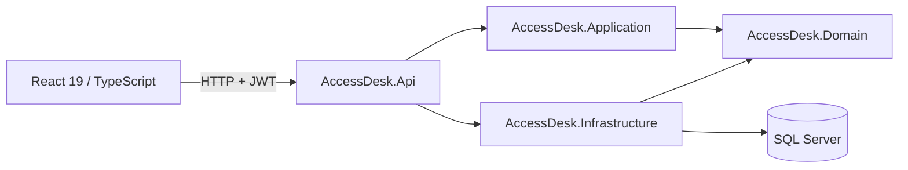
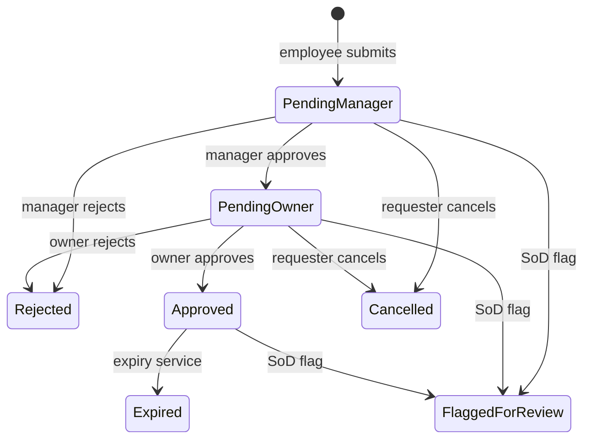

# AccessDesk Handoff

## Current state
- **DONE** — Four-layer API solution and React SPA exist; projects target .NET 10.
- **DONE** — Access request domain state transitions and manager → owner approval handlers exist.
- **DONE** — SoD rules, conflict detection/flagging, and SecurityAdmin endpoints exist.
- **DONE** — JWT login, Identity roles, refresh-token rotation, and logout/revocation code exist; token storage is not hashed.
- **DONE** — Temporary access expiry background service and request expiry transition exist.
- **DONE** — Joiner, mover, leaver API workflows exist.
- **DONE** — Access review and notification APIs/pages exist.
- **DONE** — Audit log search is read-only at repository/API surface; no SQL-level tamper protection verified.
- **DONE** — EF Core initial migration, SQL Server provider, and startup migration/seeding code exist.
- **DONE** — Unit and WebApplicationFactory integration test projects exist; integration tests use EF InMemory.
- **DONE** — CI workflow configures .NET 10 and Node 22, builds backend/frontend, and runs both test projects.
- **PARTIAL** — README, DEVLOG, KNOWN_ISSUES, INTERVIEW_NOTES document architecture and setup; README still has screenshot placeholders and EF Core version text is stale.
- **PARTIAL** — SQL Server is configured in source for LocalDB, but live migration/startup/workflows have not been verified here.
- **PARTIAL** — Build/test verification attempted on 2026-11-28; restore failed before compilation (see Known blockers).
- **TODO** — Verify API and all seeded flows against an actual SQL Server instance.
- **TODO** — Resolve MailKit/MimeKit advisories and align EF Core packages/tooling with .NET 10.
- **TODO** — Implement remaining security hardening requested in the project brief (rate limiting/lockout, hashed refresh tokens, concurrency, ProblemDetails/health, bounded pagination, security headers, dev-only seed gating, append-only test).
- **TODO** — Capture genuine screenshots; update README, known issues, interview notes, and documentation after verified work.
- **TODO** — Verify secrets/history and GitHub CI/repository polish; remote is `origin` and local main was ahead of origin by one commit at handoff.

## Next task
Resolve the local .NET restore failure, then rerun solution build and tests before starting SQL Server verification. Relevant files are `AccessDesk.slnx`, the project `.csproj` files, and local NuGet/MSBuild environment (the failure occurs before compilation and may not be a source issue).

## Known issues and verification
- `dotnet build AccessDesk.slnx` and `dotnet test AccessDesk.slnx` both exited 1 during restore. Output: `Build FAILED. 0 Warning(s) 0 Error(s)`; diagnostic log shows solution `Restore` / `_FilterRestoreGraphProjectInputItems` failed, with no actionable NuGet error. Building `src/AccessDesk.Api/AccessDesk.Api.csproj` likewise stopped at “Determining projects to restore…” with zero warnings/errors. .NET SDK 10.0.404 and runtime 10.0.15 are installed.
- `KNOWN_ISSUES.md` reports MailKit 4.11.0, MimeKit 4.11.0, and transitive System.Security.Cryptography.Pkcs 8.0.1 vulnerability advisories NU1902/NU1903; not rechecked in this session.
- SQL Server service enumeration is blocked by Windows Service Control Manager access denied; `docker` is not installed/available. `sqlcmd.exe` is installed, but no live DB connection was verified.
- No frontend build or API startup was run in this handoff session. Node 26.13.1 and npm 11.20.0 are available.
- No test case failure details are established: tests did not execute because restore failed.
- Current working tree was clean at start. Latest commit already is `d1e7ed4 WIP checkpoint before handoff`; no additional code changes were made before writing this handoff.

## Repository map
- `src/AccessDesk.Domain/` — entities, enums, base entity, and repository contracts; core request state machine: `Entities/AccessRequest.cs`.
- `src/AccessDesk.Application/` — MediatR commands, queries, handlers, validators, and pipeline behavior; submit: `AccessRequests/Commands/SubmitAccessRequestHandler.cs`, approvals: `AccessRequests/Commands/ApprovalHandlers.cs`.
- `src/AccessDesk.Infrastructure/` — EF Core context/configurations/migrations, repositories, Identity/JWT, SMTP, expiry worker, and seeder; migration: `Persistence/Migrations/20261126182221_InitialCreate.cs`.
- `src/AccessDesk.Api/` — ASP.NET composition root, controllers, exception middleware, settings; startup: `Program.cs`.
- `tests/AccessDesk.UnitTests/` — domain and application unit tests.
- `tests/AccessDesk.IntegrationTests/` — WebApplicationFactory API tests using EF InMemory.
- `frontend/src/` — React SPA; screens in `pages/`, HTTP client in `api/client.ts`, routes in `App.tsx`.
- `.github/workflows/ci.yml` — backend and frontend CI jobs. `docker-compose.yml` — SQL Server 2022, MailHog, API, and frontend services.
- Root docs: `README.md`, `KNOWN_ISSUES.md`, `DEVLOG.md`, `INTERVIEW_NOTES.md`; no `docs/` directory existed at inspection.

## Architecture and dependencies

## Access request status flow

## Data model
`ApplicationUser` (Identity user) may reference a manager; users submit `AccessRequest` records against an owned `Application`. Requests track status, requested level, approval actors/timestamps, duration, and SoD flag. `SodConflict` relates two application/level pairs. `AuditLog` optionally relates to request/user. `RefreshToken` belongs to a user. Reviews contain review items for access decisions; notifications belong to users. Enum fields are configured as strings in EF mappings.

## Environment notes
- Local verification: Windows, .NET SDK 10.0.404 / runtime 10.0.15, Node 26.13.1, npm 11.20.0, `sqlcmd.exe` available, Docker unavailable. SQL Server service status could not be checked due permissions.
- API launch profile HTTP port: 5201; HTTPS profile: 7256 and 5201. Frontend Vite: 5173. Compose maps API to 5000, frontend to 3000, SQL Server to 1433, MailHog UI to 8025/SMTP to 1025.
- Default connection in ignored `src/AccessDesk.Api/appsettings.Development.json` targets `(localdb)\mssqllocaldb`, database `AccessDeskDb`. Override with `ConnectionStrings__DefaultConnection` or user secrets. `appsettings.json` has an empty JWT secret; set `Jwt:Secret` with user secrets/environment.
- Demo accounts documented in README and hardcoded in `DatabaseSeeder`: `admin@accessdesk.dev` / `Admin@123!`; `alice@accessdesk.dev` / `Manager@123!`; `bob@accessdesk.dev` / `Owner@123!`; employees `charlie`, `diana`, `evan` at `accessdesk.dev` / `Employee@123!`. These are demo-only; seeder is currently invoked in every non-Testing environment, so environment gating remains a task.
- `DatabaseSeeder` migrates relational databases and seeds roles, demo users, apps, SoD conflict, and sample requests on startup. LocalDB install/presence and seeding/login were not verified.

## Decisions already reflected in code
- Clean Architecture keeps domain state and contracts independent of persistence and HTTP concerns.
- MediatR commands/queries separate use cases; FluentValidation runs through a pipeline behavior.
- Approval transitions live on `AccessRequest` to centralize valid status changes.
- EF enum-to-string mappings make stored statuses and levels readable.
- Refresh-token rotation revokes the old token and links its replacement; persisted values are currently plaintext and require hardening.
- Audit log API/repository expose append/search only, though no database trigger or immutable storage is configured.
- SQL Server is the intended relational provider; InMemory supports fast isolated API integration tests but does not prove SQL Server behavior.
