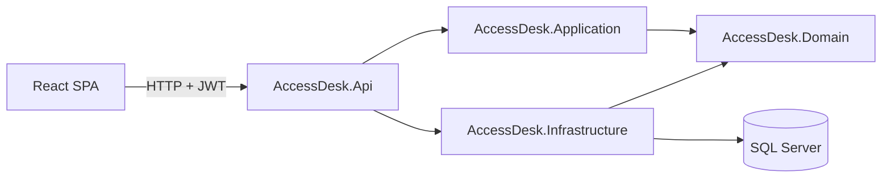
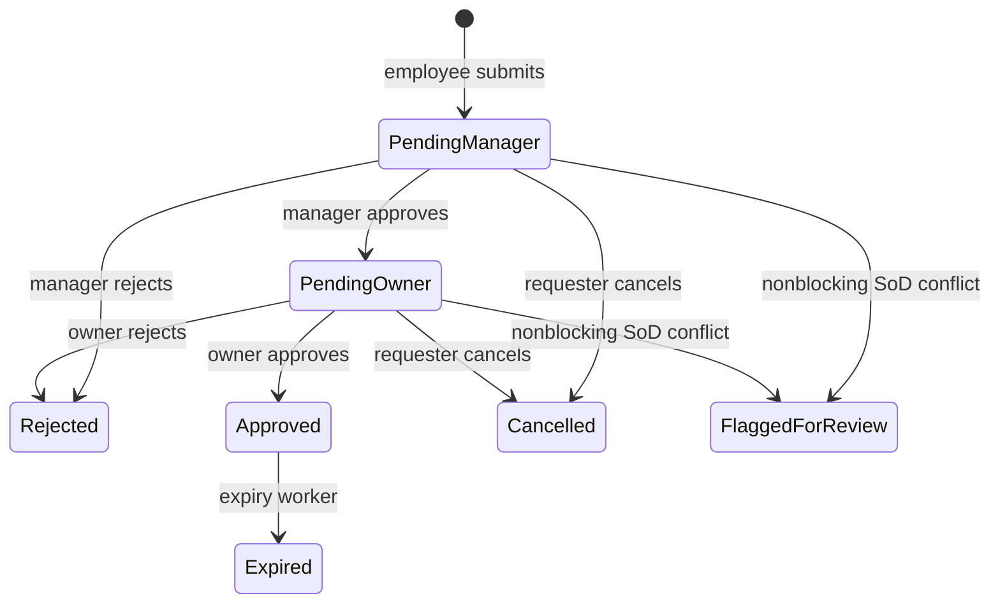

# AccessDesk Handoff

## Current status

- **DONE** — Clean Architecture .NET 10 API and React/TypeScript SPA build successfully.
- **DONE** — Request submission, manager then owner approval, rejection, cancellation, and SoD checks are implemented.
- **DONE** — SQL Server Express 2025 migrations, Development seeding, login, and the listed request, approval, SoD, review, audit, JML, and expiry flows were exercised against `AccessDeskDb` on 2026-11-28.
- **DONE** — EF Core and `dotnet-ef` are aligned at 10.0.13; MailKit is 5.0; NuGet vulnerability audit reports no findings.
- **DONE** — Rate limiting and Identity lockout, hashed refresh-token rotation/reuse response, SQL `rowversion`, generic ProblemDetails errors, `/health`, bounded pagination, CORS, and security headers are implemented.
- **DONE** — EF rejects tracked AuditLog updates/deletes and integration coverage proves both; audit API/repository surface is read-only.
- **DONE** — Unit tests (21), integration tests (10 with SQL Server opt-in enabled), and frontend production build pass on 2026-11-28.
- **DONE** — Playwright captured genuine Development UI screenshots in `docs/screenshots/`; `frontend/capture-screenshots.mjs` recreates them.
- **DONE** — README, AGENTS, interview notes, development log, known issues, MIT license, and CI build badge are present/current.
- **PARTIAL** — GitHub CI workflow is configured for .NET 10 and Node 22, but latest run status could not be checked because `gh` authentication is invalid.
- **PARTIAL** — GitHub topics and repository description are not set; `gh auth status` reports an invalid token for `AlyEl-Halawany`.
- **PARTIAL** — Git history has no detected private-key markers, AWS key IDs, or GitHub tokens; it does contain an old Compose commit with development-only SQL/JWT fallback values. Current Compose requires environment-provided values; history was not rewritten.
- **PARTIAL** — Audit is append-only through ordinary application paths, but not tamper-evident against database administrators; no hash chain or external immutable retention exists.
- **PARTIAL** — SQL Server Express is verified; Docker Compose was not run because Docker is not installed.
- **TODO** — Authenticate `gh`, then verify CI on main and add repository topics/description.
- **TODO** — Consider SQL Server-backed CI and end-to-end browser CI; current standard integration tests use EF InMemory.

## Next task

Authenticate the GitHub CLI (`gh auth login -h github.com`), then verify the latest Actions result and set the repository description/topics. Relevant configuration is `.github/workflows/ci.yml`; target repository is `AlyEl-Halawany/AccessDesk`.

## Known issues and limitations

- MailHog is not running locally; review campaign email delivery logs `SocketException (10061)` at `localhost:1025`. Campaign persistence succeeds.
- Docker is unavailable, so the full Compose environment is not verified.
- The current GitHub CLI token is invalid; remote Actions status and repo metadata remain unverified/unmodified.
- `e04df7a` contains public development-only Compose fallback credentials. They are removed from the current Compose configuration, which now requires `MSSQL_SA_PASSWORD` and `JWT_SECRET`; no production credential was identified and history was not rewritten.
- Access JWTs are stateless and remain usable until their short expiry even after refresh-token revocation or leaver processing.
- Audit rows are protected from normal application updates/deletes, but there is no cryptographic tamper detection or database-level immutable storage.
- The frontend production build succeeds with Vite's advisory that the minified JavaScript chunk exceeds 500 kB.
- Broad authorization-negative testing and production deployment hardening remain incomplete; this is a portfolio demo, not a production-ready IGA system.

## Verification evidence

- `dotnet build AccessDesk.slnx --no-restore`: success, 0 warnings/errors.
- `dotnet test AccessDesk.slnx --no-build` with `ACCESSDESK_SQLSERVER_CONNECTION` configured: 21 unit and 10 integration tests passed; SQL Server concurrency test ran (not skipped).
- `dotnet list AccessDesk.slnx package --vulnerable --include-transitive`: no vulnerable packages reported.
- `npm run build`: success; Vite chunk-size advisory noted above.
- `npm run capture:screenshots`: captured login, dashboard, new request, approval inbox, my access, audit log, JML console, and access reviews against the local running app and SQL Server.
- Development connection string is in ignored `src/AccessDesk.Api/appsettings.Development.json`; it targets `localhost\SQLEXPRESS`. Signing key for screenshot run was an ephemeral environment variable and was not committed.

## Repository map

- `src/AccessDesk.Domain/` — entities, enums, state transitions, repository contracts; approval state machine: `Entities/AccessRequest.cs`.
- `src/AccessDesk.Application/` — MediatR use cases, validators, and pipeline behavior.
- `src/AccessDesk.Infrastructure/` — EF Core context/configurations/migrations, repositories, seeder, Identity/JWT/mail, expiry worker; token handling: `Services/TokenService.cs`.
- `src/AccessDesk.Api/` — composition root, auth policies, controllers, rate limiting, middleware; startup and health endpoint: `Program.cs`.
- `tests/AccessDesk.UnitTests/` — domain/application unit tests.
- `tests/AccessDesk.IntegrationTests/` — WebApplicationFactory API tests plus opt-in real SQL Server rowversion test: `SqlServerConcurrencyTests.cs`.
- `frontend/src/` — React SPA, auth/client, guarded routes, pages; app routes: `App.tsx`.
- `frontend/capture-screenshots.mjs` — Playwright script for genuine local UI captures.
- `docs/screenshots/` — README screenshots.
- `.github/workflows/ci.yml` — backend build/tests and frontend build; `docker-compose.yml` — optional SQL/API/frontend/MailHog stack.
- Root docs: `README.md`, `AGENTS.md`, `DEVLOG.md`, `KNOWN_ISSUES.md`, `INTERVIEW_NOTES.md`.

## Architecture and dependencies

## Access request status flow

## Data model summary

`ApplicationUser` (Identity) may reference a manager. Users request access to `Application` records, producing `AccessRequest` rows with approval actors/times, status, expiry, and SQL `rowversion`. `SodConflict` pairs application/level combinations. `AccessReview` contains `AccessReviewItem` decisions. `RefreshToken` belongs to a user and stores token hashes. `AuditLog` records actor/action and optional request/user links. `Notification` belongs to a user. Enum fields are stored as strings.

## Environment notes

- Verified host: Windows 11, .NET SDK 10.0.404, runtime 10.0.15, Node 26.13.1, npm 11.20.0, SQL Server Express 2025; Docker unavailable.
- API HTTP port 5201; Vite 5173; Compose ports are documented in README.
- Local SQL connection: `Server=localhost\SQLEXPRESS;Database=AccessDeskDb;Trusted_Connection=True;MultipleActiveResultSets=true;TrustServerCertificate=True`; configure through ignored Development settings, user secrets, or `ConnectionStrings__DefaultConnection`.
- Set `Jwt:Secret` with user secrets or `Jwt__Secret` environment variable. Never commit local settings/signing keys.
- Development-only demo accounts: `admin@accessdesk.dev` / `Admin@123!`; `alice@accessdesk.dev` / `Manager@123!`; `bob@accessdesk.dev` / `Owner@123!`; `charlie@accessdesk.dev`, `diana@accessdesk.dev`, `evan@accessdesk.dev` / `Employee@123!`.

## Decisions and tradeoffs

- Domain owns workflow transitions; Application orchestrates use cases; Infrastructure implements persistence and external services.
- EF InMemory keeps most integration tests isolated and fast, but does not prove relational behavior; one opt-in SQL Server test covers rowversion conflict behavior.
- Refresh-token hashes reduce harm from database disclosure; rotation/reuse handling adds session state and transactions.
- SQL `rowversion` detects stale decisions without holding locks; callers receive conflict responses and must reload.
- Audit writes are append-only in app paths, not immutable against privileged database operators.
- Seed data runs only in Development; local signing keys and connection strings stay outside Git.
