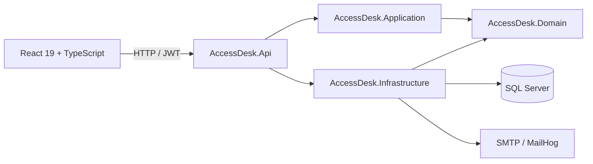
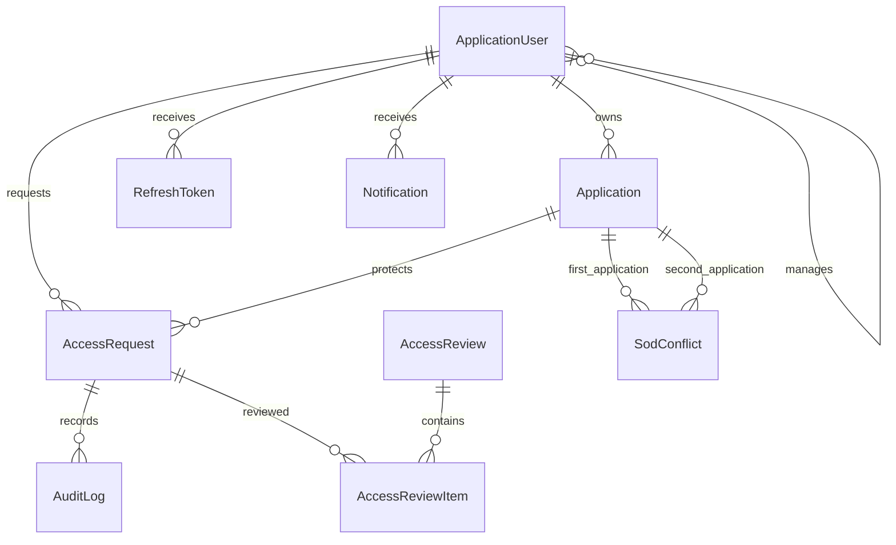
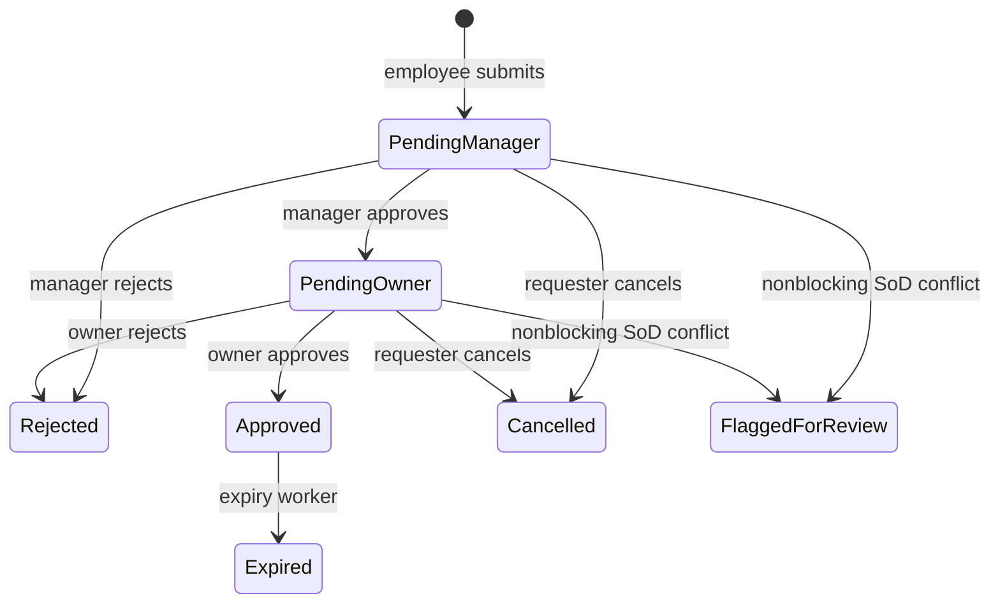
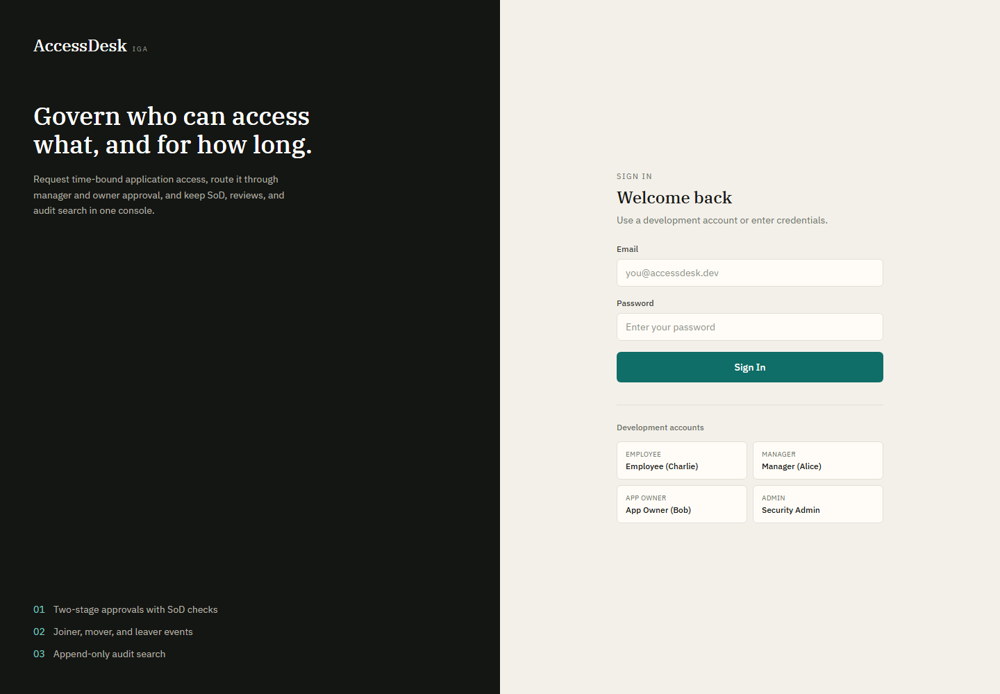
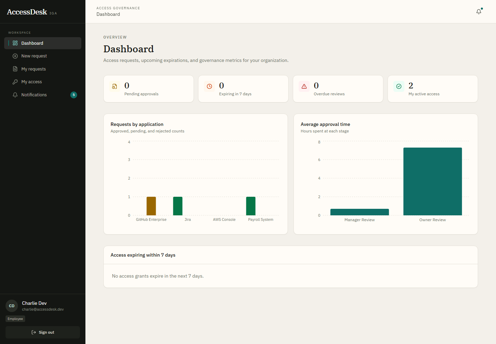
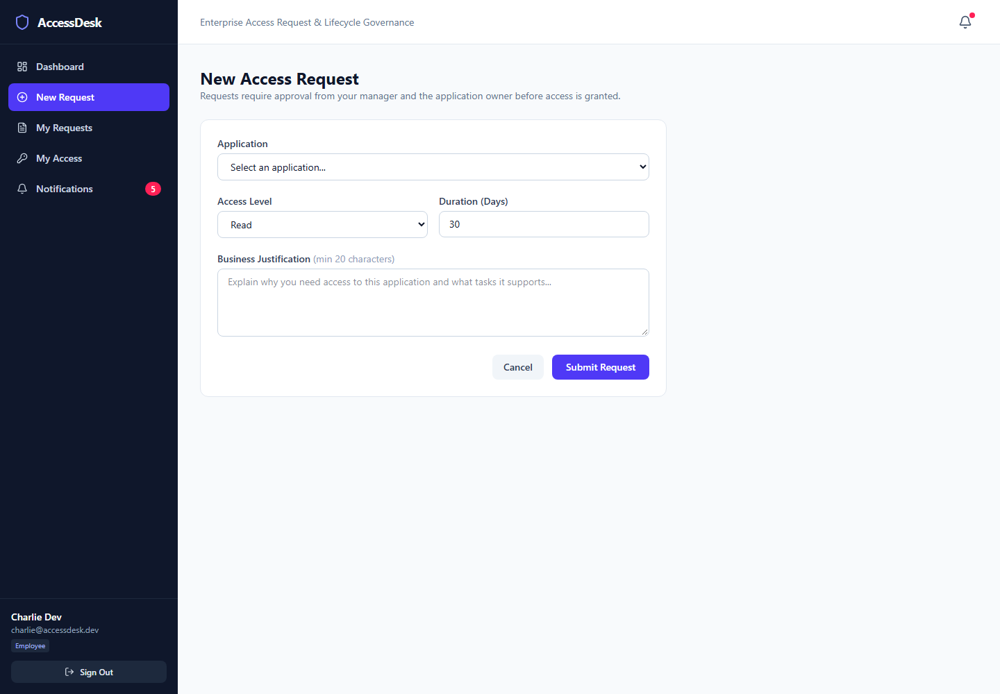
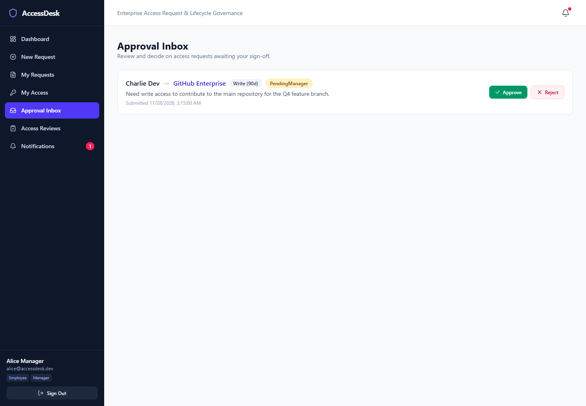
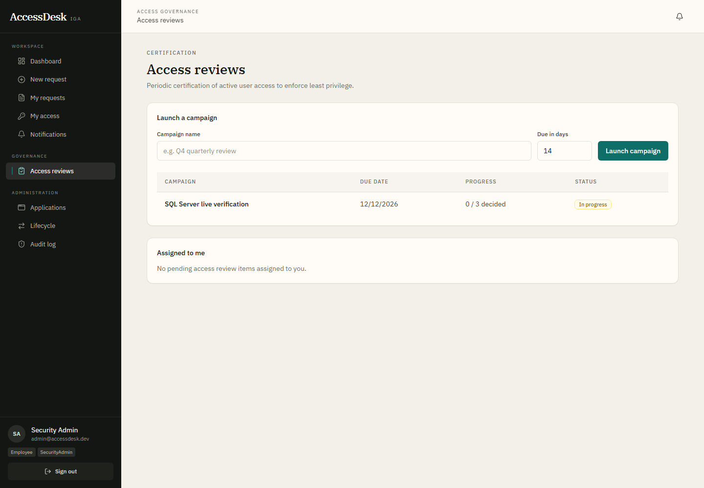

# AccessDesk

[](https://github.com/AlyEl-Halawany/AccessDesk/actions/workflows/ci.yml)

AccessDesk is a portfolio-scale Identity Governance and Administration (IGA) app. Employees request time-bound application access; managers and application owners approve it; SoD rules, JML events, access reviews, expiry processing, and audit search govern the resulting access. It demonstrates IAM/IGA controls but does not claim regulatory compliance or production readiness.

## Features

- Two-stage manager and app-owner approval, with reasons and request history.
- Role-based authorization for Employee, Manager, AppOwner, and SecurityAdmin.
- Blocking and review-flagging Separation of Duties rules.
- Time-bound grants and an expiry background service.
- Joiner, mover, and leaver workflows; leavers lose active grants and refresh sessions.
- Access review campaigns, reviewer decisions, and notifications.
- Read-only audit search; tracked audit updates/deletes are rejected by EF.
- Short-lived JWTs, rotating hashed refresh tokens with replay detection, login throttling, account lockout, rowversion concurrency, ProblemDetails, and `/health`.

## Architecture

Clean Architecture separates business rules from HTTP and persistence. Dependencies point inward: Application depends on Domain contracts; Infrastructure implements them; the API composes the layers. The React app uses HTTP/JWT.



### Data model



`AccessRequest` stores the requested level, justification, duration, status, approvers/timestamps, and SQL Server `rowversion`. `RefreshToken` stores a SHA-256 digest, never the raw bearer token. Audit writes are append-only through the application path; database administrators can still directly alter rows.

## Authentication and approval flow

Identity hashes passwords. Access tokens are short-lived JWTs. Refresh rotates a random token in a database transaction; only its hash is stored. Reuse of a revoked token revokes the user's other active refresh tokens. Login is limited to five attempts per IP per minute; Identity locks an account after five failed password checks.



A blocking SoD rule rejects the submission. A nonblocking rule flags it for SecurityAdmin review. The sample rule pairs Payroll Admin and Financial Audit Admin access.

Controllers enforce the role boundaries: employees request/view their own access; managers and owners approve their respective steps; SecurityAdmins manage applications, SoD, audit search, access reviews, and JML events.

## Audit and concurrency

Audit search is restricted to SecurityAdmin. The repository exposes add/search, the API exposes GET only, and `AccessDeskDbContext` rejects tracked updates/deletes; integration tests cover both paths. This is not immutable storage or cryptographic tamper evidence.

SQL Server generates a new `rowversion` for each access-request update. A stale concurrent approval produces HTTP 409 ProblemDetails. An opt-in SQL Server test verifies the second update fails.

## Screenshots

Captures of the running Development app are stored in [`docs/screenshots/`](docs/screenshots/).

| Screen | Screenshot |
|---|---|
| Login |  |
| Dashboard |  |
| New request |  |
| Approval inbox |  |
| My access |  |
| Audit log |  |
| JML console |  |
| Access reviews |  |

To recreate these genuine screenshots after starting the API and Vite app, install frontend dependencies and run `npm run capture:screenshots` from `frontend/`. The script signs in with the Development demo accounts and writes to `docs/screenshots/`.

## Technology stack

- **Backend:** ASP.NET Core/.NET 10, C#, EF Core 10.0.13, SQL Server.
- **Application:** MediatR 12.4.1, FluentValidation 11.11, Serilog, ASP.NET Core Identity, JWT bearer, MailKit 5.
- **Frontend:** React 19, TypeScript 7, Vite 8, React Router 7, TanStack Query 5, Tailwind 4, Recharts 3.
- **Tests:** xUnit 2, Moq, FluentAssertions, WebApplicationFactory, EF InMemory; opt-in SQL Server concurrency test.
- **Tooling:** local `dotnet-ef` 10.0.13, Docker Compose, GitHub Actions (.NET 10, Node 22).

## Local setup

Prerequisites: .NET 10 SDK, Node.js LTS/npm, and SQL Server Express/LocalDB (or Docker for Compose).

### Configure database and JWT

The ignored Development settings file `src/AccessDesk.Api/appsettings.Development.json` uses `localhost\SQLEXPRESS`. Change `ConnectionStrings:DefaultConnection` there or set `ConnectionStrings__DefaultConnection` using environment/user-secrets. Example:

```text
Server=localhost\SQLEXPRESS;Database=AccessDeskDb;Trusted_Connection=True;MultipleActiveResultSets=true;TrustServerCertificate=True
```

Keep development settings and signing keys out of Git. Store a local signing key with user-secrets:

```powershell
dotnet user-secrets init --project src/AccessDesk.Api
dotnet user-secrets set "Jwt:Secret" "Replace-With-A-Local-Secret-At-Least-32-Chars" --project src/AccessDesk.Api
```

### Run the API

```powershell
dotnet tool restore
dotnet ef database update --project src/AccessDesk.Infrastructure --startup-project src/AccessDesk.Api
dotnet run --project src/AccessDesk.Api --launch-profile http
```

The API listens at `http://localhost:5201`; Swagger is `/swagger`, health is `/health`. Startup migrates in non-Testing environments and seeds demo data only in Development.

### Run the frontend

```powershell
cd frontend
npm ci
npm run dev
```

Vite serves `http://localhost:5173` and proxies `/api` to port 5201.

### Docker Compose

In PowerShell, provide local-only values first (Compose rejects missing values):

```powershell
$env:MSSQL_SA_PASSWORD = Read-Host "Local SQL Server SA password"
$env:JWT_SECRET = Read-Host "Local JWT signing secret (32+ characters)"
docker compose up --build
Remove-Item Env:MSSQL_SA_PASSWORD, Env:JWT_SECRET
```

Compose exposes frontend `http://localhost:3000`, API `http://localhost:5000`, SQL Server on 1433, and MailHog UI on 8025.

### Development demo accounts

These accounts are seeded only in Development; never reuse their passwords.

| Role | Email | Password |
|---|---|---|
| SecurityAdmin | `admin@accessdesk.dev` | `Admin@123!` |
| Manager | `alice@accessdesk.dev` | `Manager@123!` |
| AppOwner | `bob@accessdesk.dev` | `Owner@123!` |
| Employee | `charlie@accessdesk.dev` | `Employee@123!` |
| Employee | `diana@accessdesk.dev` | `Employee@123!` |
| Employee | `evan@accessdesk.dev` | `Employee@123!` |

## Build and tests

```bash
dotnet build AccessDesk.slnx
dotnet test AccessDesk.slnx
cd frontend && npm ci && npm run build
```

The normal API integration tests use EF InMemory. For the SQL Server rowversion test, set `ACCESSDESK_SQLSERVER_CONNECTION` and run:

```powershell
$env:ACCESSDESK_SQLSERVER_CONNECTION = "Server=localhost\SQLEXPRESS;Database=AccessDeskDb;Trusted_Connection=True;TrustServerCertificate=True"
dotnet test tests/AccessDesk.IntegrationTests/AccessDesk.IntegrationTests.csproj
```

## Design decisions and tradeoffs

- **Clean Architecture:** isolates business rules and makes provider swaps/test doubles possible; it adds project and mapping boundaries.
- **MediatR:** makes use cases and validation explicit; it adds indirection, so simple reads remain direct.
- **Refresh-token rotation:** limits replay and enables revocation; an already-issued access JWT remains valid until expiry.
- **Append-only audit path:** repository/controller/EF controls prevent ordinary app mutation; a database administrator can still edit rows without immutable external storage.
- **Rowversion:** detects stale approvals without long-held locks; a conflicting client must reload and retry.

## Security considerations and future improvements

This is a learning project, not a production deployment. Production use would need external identity/MFA, managed secrets, operational monitoring, backup and retention policies, database-level immutable audit storage, and an HRIS integration. SMTP is local MailHog; campaign persistence succeeds even when SMTP is unavailable.

Future work: OIDC/Entra sign-in, durable expiry scheduling and delivery retries, SQL integration tests in CI, browser end-to-end tests in CI, tenant-aware administration, and immutable external audit retention.
