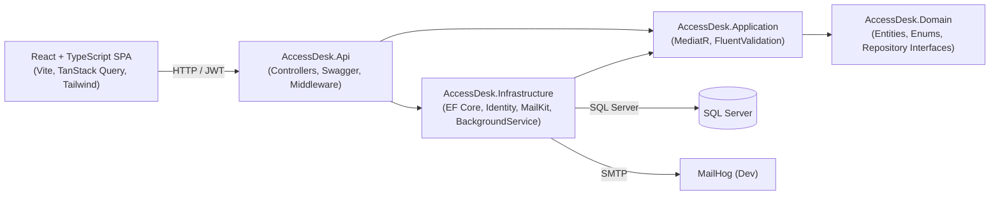

# AccessDesk

AccessDesk is an enterprise access request and identity governance platform. Employees request time-bound access to internal applications, managers and application owners review and approve or reject requests in a two-stage workflow, temporary access expires automatically, Separation of Duties (SoD) conflicts are enforced, and every security-relevant event is recorded in an append-only audit log.

## Architecture

AccessDesk follows **Clean Architecture** with strict inward dependencies:



## Tech Stack

- **Backend:** ASP.NET Core Web API (.NET 10), C#, Entity Framework Core 9, SQL Server
- **Patterns & Libraries:** Clean Architecture, MediatR (CQRS), FluentValidation, Serilog, Swashbuckle (Swagger/OpenAPI)
- **Authentication:** ASP.NET Core Identity + JWT Bearer access tokens + rotating refresh tokens (RBAC: `Employee`, `Manager`, `AppOwner`, `SecurityAdmin`)
- **Testing:** xUnit, Moq, FluentAssertions, `WebApplicationFactory` integration tests
- **Frontend:** React 19, TypeScript, Vite, React Router, TanStack Query, Tailwind CSS, Recharts
- **DevOps:** Docker Compose (API, SQL Server 2022, Nginx frontend, MailHog), GitHub Actions CI

## Running Locally

### Prerequisites
- [.NET 10 SDK](https://dotnet.microsoft.com/download/dotnet/10.0)
- [Node.js LTS](https://nodejs.org/)
- SQL Server LocalDB / SQL Server Express (or Docker)

### 1. Backend
```bash
# Configure local JWT secret via user-secrets
dotnet user-secrets init --project src/AccessDesk.Api
dotnet user-secrets set "Jwt:Secret" "Your-Dev-Signing-Key-At-Least-32-Chars-Long!" --project src/AccessDesk.Api

# Run the API (applies EF Core migrations and seeds demo data on startup)
dotnet run --project src/AccessDesk.Api
```
Swagger UI is available at `http://localhost:5000/swagger` (or the port shown in console output).

### 2. Frontend
```bash
cd frontend
npm install
npm run dev
```
The React app runs at `http://localhost:5173` and proxies `/api` requests to `http://localhost:5000`.

### 3. Running with Docker Compose
```bash
docker compose up --build
```
- **Frontend:** `http://localhost:3000`
- **API & Swagger:** `http://localhost:5000/swagger`
- **MailHog Web UI:** `http://localhost:8025`

## Demo Accounts

| Role | Email | Password |
|---|---|---|
| SecurityAdmin | `admin@accessdesk.dev` | `Admin@123!` |
| Manager | `alice@accessdesk.dev` | `Manager@123!` |
| AppOwner | `bob@accessdesk.dev` | `Owner@123!` |
| Employee | `charlie@accessdesk.dev` | `Employee@123!` |
| Employee | `diana@accessdesk.dev` | `Employee@123!` |
| Employee | `evan@accessdesk.dev` | `Employee@123!` |

## API Overview

| Area | Endpoints | Auth / Role |
|---|---|---|
| Auth | `POST /api/auth/login`, `refresh`, `logout`, `GET /api/auth/me` | Anonymous / Authenticated |
| Requests | `GET /api/requests/my`, `my-access`, `pending`, `POST /api/requests`, `{id}/approve`, `{id}/reject`, `{id}/cancel`, `{id}/sod-resolve` | Authenticated / Manager / AppOwner / SecurityAdmin |
| Applications | `GET /api/applications`, `POST/PUT /api/applications` | Authenticated / SecurityAdmin |
| SoD Rules | `GET/POST /api/sod-conflicts` | SecurityAdmin |
| Access Reviews | `GET/POST /api/reviews`, `GET /api/reviews/my-pending`, `POST /api/reviews/items/{id}/decide` | Manager / SecurityAdmin |
| JML Events | `POST /api/jml/joiner`, `mover`, `leaver`, `GET /api/jml/users` | SecurityAdmin |
| Audit Log | `GET /api/audit-logs` (read-only search) | SecurityAdmin |
| Dashboard | `GET /api/dashboard` | Authenticated |
| Notifications | `GET /api/notifications`, `unread-count`, `POST {id}/read`, `read-all` | Authenticated |

## Screenshots

- `[Screenshot Placeholder: Login & Role-Based Dashboard]`
- `[Screenshot Placeholder: Multi-Stage Approval Inbox]`
- `[Screenshot Placeholder: SecurityAdmin Audit Log & JML Console]`
